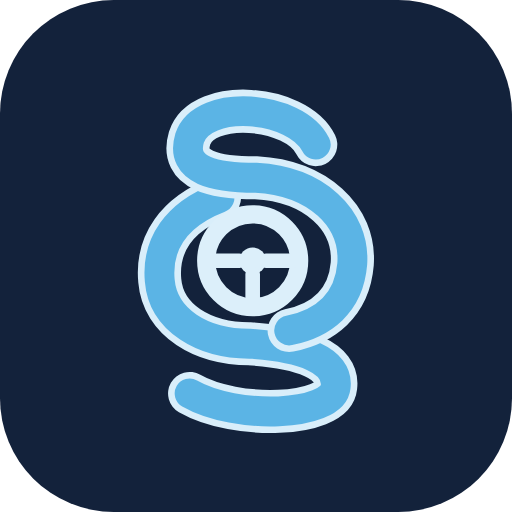

# SteerScore - 조향 기반 운전점수 평가 및 안전운전 지원 서비스



| 항목 | 내용 |
|---|---|
| <b>앱 이름</b> | SteerScore (스티어스코어) |
| <b>한 줄 소개</b> | SteerScore는 차량의 속도·조향각·방향지시등 데이터를 함께 분석해 운전 습관을 평가하고, 경로별 예상 운전점수 비교·감점 알림·주행 리포트를 제공하는 Pleos Connect 기반 안전운전 지원 앱입니다. |
| <b>Release</b> | https://github.com/steerscore-team/steer-score/releases/tag/v1.0 |
| <b>APK</b> | 저장소 [`apk/SteerScore_SteerScore_release.apk`](apk/SteerScore_SteerScore_release.apk) (release 빌드, v1.0.0) · [Release에서 내려받기](https://github.com/steerscore-team/steer-score/releases/download/v1.0/SteerScore_SteerScore_release.apk) |
| <b>시연 영상</b> | [SteerScore_demo.mp4](https://github.com/steerscore-team/steer-score/releases/download/v1.0/SteerScore_demo.mp4) (약 6분) |
| <b>테스트 환경</b> | Pleos Connect Emulator v2.1.0 (Android 14 / API 34, x86_64) · 화면 2560×1440, 160 dpi |

## 주요 기능
- <b>조향 기반 운전점수:</b> 급가속·급감속·과속에 더해 급차선변경, 방향지시등 없는 차선변경·회전, 연속 차선변경(칼치기), 급커브를 조향각·방향지시등으로 평가합니다. 차선변경·교차로 회전·커브를 구분합니다.
- <b>주행 전 · 경로별 예상 점수:</b> 자주 가는 목적지로 길안내를 시작하면, 내비게이션이 제안한 경로마다 예상 점수를 비교하고 고른 경로를 내비게이션 안내에 반영합니다.
- <b>주행 중 · 감점 알림:</b> 감점 순간 짧은 알림음(또는 음성 코칭)으로 알립니다. 내비게이션을 앞에 띄워도 계속 동작합니다.
- <b>주행 후 · 리포트와 누적 분석:</b> 이번 주행 점수, 지도 위 감점 위치, 시간순 기록을 보여 주고, 누적 분석에서 내 운전 점수와 반복 감점 지점, 다음 주행 미션을 제시합니다.
- <b>시연 모드:</b> 에뮬레이터 시연용 기능(시나리오 재생, 가상 주행)을 켜고 끕니다.

## 실행 방법
1. [Pleos Connect 개발 환경 설정 가이드](https://document.pleos.ai/docs/connect/guide/getting-started/application-development/setup-connect-sdk-emulator)에 따라 Pleos Connect Emulator를 실행합니다.
2. 앱을 설치합니다. `-g`는 차량 속도·위치 권한을 미리 허용합니다.
   ```bash
   adb install -r -g apk/SteerScore_SteerScore_release.apk
   ```
3. 사용합니다.
   - 실제 차량: 기어를 D로 바꾸면 주행 기록이 시작되고, P로 바꾸면 끝나며 리포트가 열립니다.
   - 에뮬레이터: 아래 <b>시연 모드</b>를 켜고 <b>시나리오 재생</b>으로 시나리오를 재생하거나, <b>실시간 → 주행 시작</b>으로 가상 주행을 실행합니다.
   - <b>경로 추천</b>에서 자주 가는 목적지를 누르면 길안내가 시작되고 경로별 예상 점수를 비교할 수 있습니다.

## 테스트 환경과 필요한 설정
| 항목 | 내용 |
|---|---|
| 에뮬레이터 | Pleos Connect Emulator v2.1.0 (Android 14 / API 34, x86_64) |
| 화면 규격 | 2560×1440, 160 dpi (가로 화면) |
| 실행 옵션 | `-dns-server 8.8.8.8,1.1.1.1` (내비게이션 길안내에 필요) |
| 권한 | `adb install -r -g`로 설치 |
| 차량 신호 | Virtual Console: `adb forward tcp:8088 tcp:8088` 후 http://127.0.0.1:8088/ |
| 사용 SDK | Pleos Vehicle SDK 2.3.2, FusedLocation 1.1.3, NaviHelper 3.0.5, TextToSpeech 3.3.1, Gleo AI App Integration |

## 빌드
Android SDK 위치를 `ANDROID_HOME` 또는 `local.properties`(`sdk.dir=...`)로 지정한 뒤 실행합니다. JDK 17이 필요합니다.
```bash
./gradlew assembleRelease      # app/build/outputs/apk/release/
./gradlew testDebugUnitTest    # 단위 테스트
```

## 향후 계획
- <b>Gleo AI 음성 대화:</b> 앱이 제공하는 감점 데이터(`assets/schema.json`)로, 운전자가 "방금 왜 감점됐어?"라고 물으면 Gleo AI가 원인을 설명하도록 적용합니다(Pleos 검토 후).
- <b>Gleo 기반 음성 안내:</b> 정해진 문장의 음성 코칭을 Gleo AI 기반 대화형 안내로 바꿉니다.
- <b>지도·경로 데이터:</b> 앱에 내장한 OpenStreetMap 데이터를 현대오토에버 ROUTO API로 대체합니다.

## AI 활용 고지
이 프로젝트는 개발 과정 일부에 생성형 AI(Anthropic Claude)를 활용했습니다.
- <b>코드:</b> 전체 코드 정리(구조 정리·리팩터링, 주석 정리)와 공개용 GitHub 저장소 정리(필요한 코드 선별, 커밋 기록 정리)
- <b>문서:</b> README 작성
- <b>시연 영상:</b> 촬영은 팀이 직접 했으며, 촬영본을 이용한 영상 제작(편집)과 자막 생성에 AI를 활용

기획과 기능 설계, 결과 확인은 팀이 직접 했으며, AI가 작성한 내용은 팀이 검토했습니다.

## 데이터 출처
지도와 경로 데이터: © OpenStreetMap contributors (ODbL)
